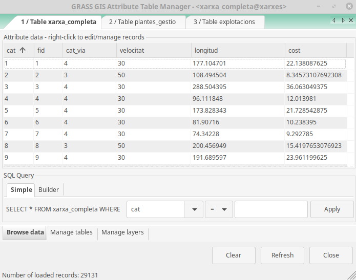
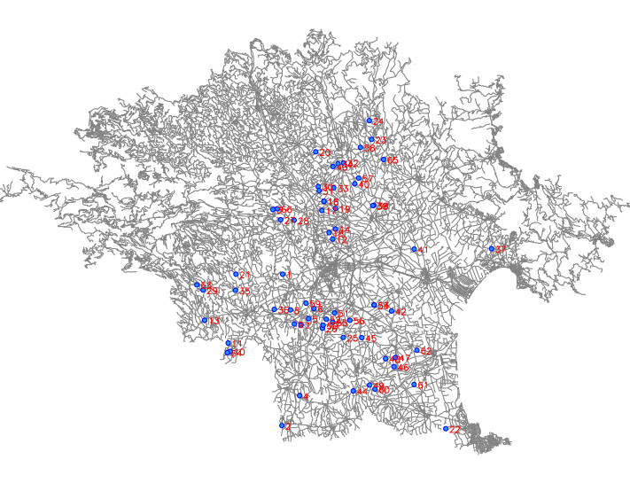
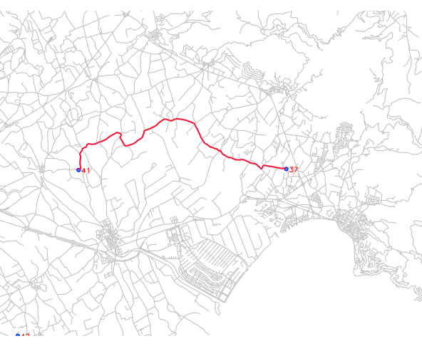
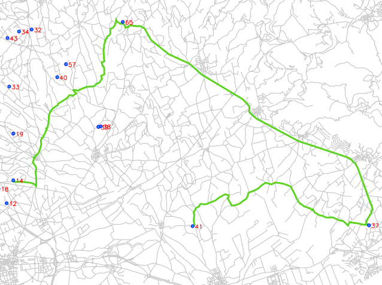
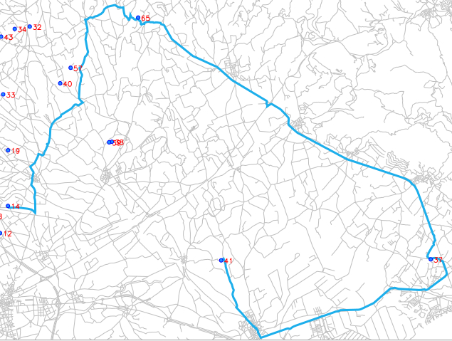
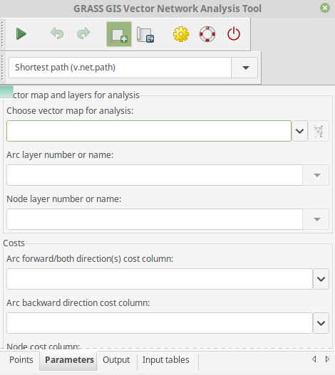
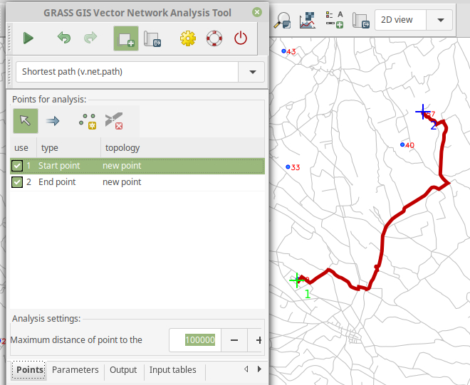
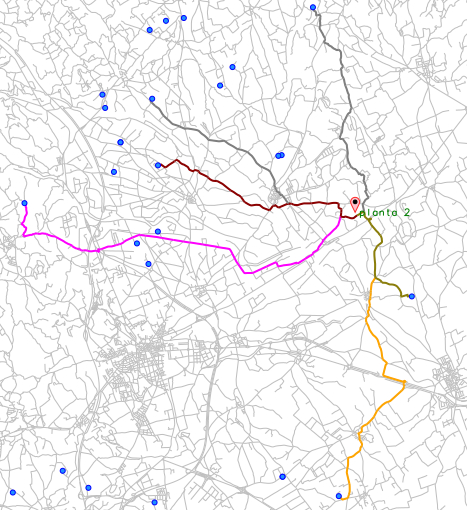
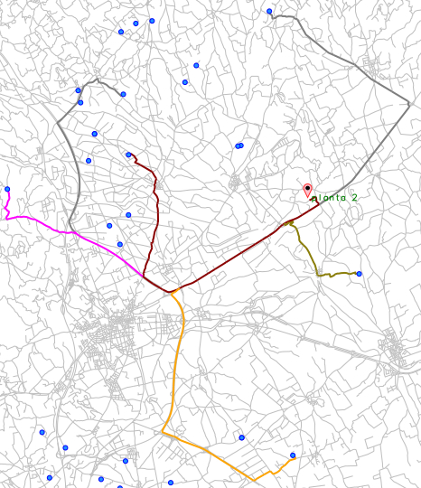
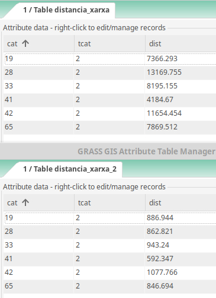

# Exercicis d'anàlisis de xarxes amb GRASS GIS

A continuació es mostren un seguit d'anàlisis relacionats amb xarxes, que es poden dur a terme amb GRASS GIS i amb el conjunt d'eines que es troben al paquet _**v.net**_.

## 1. La preparació de la xarxa

Abans de començar qualsevol exercici relatiu a l'anàlisi de xarxes, per senzill que aquest sigui, és precís preparar les dades amb les quals volem treballar. Per als casos d'ús que a continuació es motraran, s'utilitzaran tres capes:

- Xarxa de carreteres de la comarca de l'Alt Empordà. Font: [OSM](https://www.openstreetmap.org)
- Ubicació de tres plantes de gestió de residus ramaders. Font: Elaboració pròpia
- Ubicació d'un conjunt d'explotacions. Font: Elaboració pròpia

### 1.1 Preparant GRASS: Creació d'un mapset de treball, i importació de dades

- El primer pas, consisteix en crear un _location_ y un _mapset_ de GRASS GIS amb un sistema de referència **EPSG:25831**
- En acabat, procedim a importar les tres capes amb la comanda o eina **_v.import_**
- Carreguem i simbolitzem totes les capes

#### 1.2 Crear la xarxa: assignació de costos

- _**v.clean**_ per segmentar tots els arcs a cada intersecció:
```sql
  $ v.clean input=xarxa_cost@xarxes type=line output=xarxa_clean tool=break
```
- A continuació, crearem una nova columna amb nom **[velocitat]**, a la que assignarem una velocitat estàndard considerant la seva categoría. En primer lloc cal obrir la taula d'atributs de la capa **xarxa_clean**, i a l'apartat Add column, esciure el nom de la nova columna, especificant que serà de tipus enter , i fem un clic al botó **Add** per finalitzar.

- El següent pas consistirà en donar valor a aquesta columna, per a cada arc de la xarxa en funció de la seva categoria. Ens posem sobre el nom de la columna, fem botó dret, y seleccionem l'opció **Field calculator**. Dins l'apartat _Query_, escribim les següents sentències SQL:  

``` sql
UPDATE xarxa_clean SET velocitat = 120 WHERE  cat_via = 1
UPDATE xarxa_clean SET velocitat = 90 WHERE  cat_via = 2
UPDATE xarxa_clean SET velocitat = 50 WHERE  cat_via = 3
UPDATE xarxa_clean SET velocitat = 30 WHERE  cat_via = 4
```
- A continuació, cal crear una nova columna que durà per nom **[longitud]**, de tipus decimal (3), seguint el mateix procés anteriorment mostrat i, una vegada creada, fem un clic amb el botó dret del mouse sobre la capçalera i activem l'opció Calculate > Line length.

- Finalment, crearem una nova columna anomenada **[cost]**, de tipus decimal, que actualitzarem amb el següent valor de cost: el temps necessari per a recórrer un arc, en segons, donada la seva longitud i la velocitat màxima de la via. Així, una vegada creada la nova columna fem un clic sobre la capçalera per acabar seleccionant novament l'opció **Field calculator**.

```sql
UPDATE xarxa_clean SET cost =  (longitud  /  (velocitat  * 1000 / 3600))
```
- Amb aquestes senzilles passes ja tenim la xarxa preparada, degudament segmentada, i amb la taula d'atributs completa en la qual hem afegit un cap de velocitat màxima de la via, longitud de cadascun dels arcs, i el cost que suposa recórrer cadascun dels arcs.

#### 1.3 Crear la xarxa: connectar nodes a la xarxa

- A més de la capa de carreteres, disposem de dues capes de punts que voldrem connectar a la xarxa, i que representen les ubicacions de les plantes de gestió de les explotacions a les quals cal donar servei. El procés a seguir serà connectar les plantes de gestió a _layer 2_ de la xarxa (els arcs estan emmagatzemats al _layer 1_), i les explotacions al _layer 3_, i posteriorment vincularem les seves taules d'atributs.

- Accedim al menú Vector > Network Analysis > Network preparation. A la finestra emergent, dins la pestanya _Required_ seleccionem l'opció **connect**. A la pestanya _Arcs_ indiquem sobre quina capa volem treballar (**xarxa_clean**), a la pestanya _Nodes_ activem la casella **Snap points to network** i seleccionem la capa **plantes_gestio** verificant que es connectaran al nivell 2. Finalment activem la pestanya _Optional_ i donem un nom de sortida a la capa resultant (**xarxa_pas1**), i definim un llindar de connexió de **500** metres:
```sql
$ v.net -s input=xarxa_clean@xarxes points=plantes_gestio@xarxes output=xarxa_pas1 operation=connect arc_type=line threshold=500
```

- Repetim novament el pas anterior, però aquesta vegada seleccionant la capa **xarxa_pas1** com a capa d'entrada, la capa **explotacions** com a capa de nodes, connectant-la al nivell o _layer_ **3**, i amb el nom de sortida **xarxa_completa**:
```sql
$ v.net -s input=xarxa_pas1@xarxes points=explotacions@xarxes output=xarxa_completa operation=connect arc_type=line node_layer=3 threshold=500
```

- El següent pas, consistirà en vincular les taules d'atributs de les capes **plantes_gestio** i **explotacions** a la capa **xarxa_completa** als nivells **2** i **3**, respectivament. Per a dur a terme aquesta tasca cal obrir la taula d'atributs de la capa **xarxa_completa** i activar la pestanya _Manage layers_. En l'apartat Add layer seleccionem primerament la capa **plantes_gestio** i la vinculem al nivell 2 tot fent un clic al botó **Add layer**. Seguidament fem el mateix amb la capa **explotacions** i el nivell 3.



## 2. Anàlisis bàsics

Una vegada degudament preparada la xarxa amb la qual hem de dur a terme els diferents anàlisis de xarxes, i carregades les capes de les explotacions i de les plantes de gestió, que podem etiquetar amb el valor de la columna **[cat]**, començarem per veure els anàlisis més senzills que es poden dur a terme amb GRASS GIS.



### 2.1 Obtenció de la ruta més curta entre dos punts de la xarxa (explotacions)

#### Via algoritme v.net.shortest

- Accedirem al menú Vector > Network Analysis > Shortest path (_v.net.path_). En el quadre de diàleg de l'eina, a la pestanya _Required_ definirem en primer lloc el nom de la capa que conté la xarxa viària amb la qual treballem (**xarxa_completa**), donarem un nom de sortida a la capa resultant (**ruta_sense_cost**). Finalment, donat que les explotacions estan conectades a la xarxa en el layer 3, en l'apartat _Node layer_ seleccionarem el valor **3**. Activarem la pestanya _Optional_, i en l'apartat _or enter values directly:_ indicarem quines explotacions volem connectar mitjançant la ruta més curta. Per exemple, en el cas de voler connectar les explotacions amb el valor **41** i **37** presents en la columna **[cat]** de la seva taula d'atributs, escriurem la següent línia:
```sql
1 41 37
```


- Si la nostra ruta a ha de passar per dos o més punts, cal afegir noves línies en l'apartat de parades on el destí de la primera línia, ha de ser l'origen de la segona, i axí successivament:

```sql
1 41 37
2 37 65
3 65 14
```


- Si finalment optem per repetir l'anàlisis anterior però, aquesta vegada incloent-hi el factor cost que hem calculat anteriorment, caldrà activar la pestanya _Cost_ i en el paràmetre _Arc forward/both direction(s) cost column_ indicar quin es el nom de la columna de cost en la taula d'atributs: **cost**.



#### Via panell GRASS GIS Network Analysis Tool

- Alternativament, a l'algortime _v.net.path_ GRASS GIS ofereix la possiblitat de dur a terme aquests mateixos càlculs però d'una manera una mica més dinàmica, amb l'eina Vector network analysis tool accessible des del menú Vector > Network Analysis.



- Per començar, a la pestanya _Parameters_ indicarem la capa sobre la qual treballarem (**xarxa_completa**) els layers que intervindran en l'anàlisi (**1** i **3**), i seleccionarem el nom de la columna que emmagatzema els valors de cost.

- Seguidament activarem la pestanya _Points_ on haurem de definir les parades o punts pels quals volem passar. La limitació però d'aquesta eina més interactiva, es que només podem utilitzar un punt d'origen i un punt de destí, sense la possiblitat de definir punts intermitjos de pas, com si podem fer amb l'eina **v.net.path**.



El resultat, si es considera satisfactori es pot desar com una nova capa temporal en el mapset de treball.

### 2.2 Obtenció de la ruta més curta, i distancia, entre núvol de punts i una destinació

- L'eina **v.net.distance** ens permet obtenir la ruta més curta entre un conjunt de punts, i un punt de destí, a través de la xarxa, amb la possiblitat de considerar el cost de desplaçament per la xarxa. En l'exemple següent, es calcula la distancia existent entre un conjunt d'explotacions (_node layer 3_) i una de les plantes de gestió (_node layer 2_). En el primer cas, no es considera el cost de desplaçament associat a cada arc i per tant la distancia més curta s'avalua en metres mentre que, en el segon cas, si es té en compte la columna que emmagatzema el valor de costa i per tant, la ruta més curta s'avalua en temps de desplaçament.

```sql
v.net.distance input=xarxa_completa out=distancia_xarxa arc_type=line from_layer=3 from_cats=42,41,65,33,28,19 to_layer=2 to_cats=2
```


```sql
v.net.distance input=xarxa_completa output=distancia_xarxa_cost arc_type=line from_layer=3 from_cats=42,41,65,33,28,19 to_layer=2 to_cats=2 arc_column=cost
```


- A continuació es mostren les respectives taules d'atributs:




### 2.3 Obtenció de les distancies i les rutes, entre tots els elements d'una mostra

```sql
v.net.allpairs input=xarxa_completa out=distancia_tots node_layer=3 cats=65,43,40,18 arc_column=cost
```


